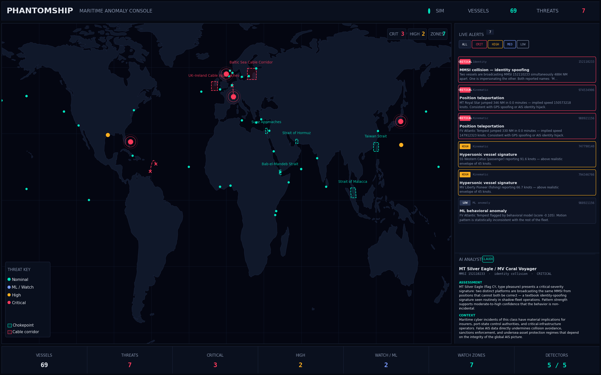

<div align="center">


# PhantomShip

**Real-time maritime cyber-intelligence console — detects AIS spoofing, identity hijacks, dark-activity events, and behavioral anomalies across a live global vessel feed.**

[](https://github.com/USER/phantomship/actions/workflows/ci.yml)
[](https://www.python.org/)
[](https://www.typescriptlang.org/)
[](LICENSE)

</div>

---

## Overview

**PhantomShip** is a defensive cybersecurity tool that treats the global AIS (Automatic Identification System) stream as an adversarial data source. The AIS protocol is unauthenticated and unencrypted, which makes it routinely targeted for **GPS spoofing**, **identity hijack**, **dark-activity sanctions evasion**, and **seabed-cable reconnaissance**. PhantomShip ingests live vessel telemetry, runs it through a stack of rule-based and ML detectors, and surfaces threats on an interactive 3D globe alongside Claude-generated analyst write-ups.

Built as a self-contained portfolio project: clone, `docker compose up`, open `localhost:5173`. No API keys required to demo — a deterministic simulator with planted anomalies runs out of the box.

## What it does

- **Tracks** the live AIS feed via [AISStream.io](https://aisstream.io), or runs a high-fidelity offline simulator (default) so it demos cleanly with zero setup.
- **Detects** five distinct threat classes using a rule-based + ML detector stack.
- **Visualizes** 180+ live vessels on an interactive WebGL globe with auto-rotation, threat-graded color coding, and animated arcs for impossible-jump events.
- **Explains** each detection in plain English via the Anthropic API, with a deterministic fallback when no key is configured.
- **Ships** as one `docker compose` command with full CI on every commit.

## Detectors

| Detector | Threat class | Signature |
|---|---|---|
| **Kinematic** | GPS spoofing, AIS replay | Speed > 45 kn on cargo class; consecutive positions imply > 80 NM in ≤ 10 min |
| **Identity** | MMSI hijack (shadow fleet) | Two distinct platforms broadcasting one MMSI > 30 NM apart at the same wall-clock |
| **Dark activity** | Sanctions evasion, cable interference | Transponder shutdown > 30 min last seen inside a critical zone |
| **Loitering** | Seabed reconnaissance, illicit STS transfers | Sustained < 1.5 kn movement inside a chokepoint or cable corridor |
| **ML anomaly** | Novel / multivariate behavior | Isolation Forest on 5-dim motion features (mean/std SOG, course variance, displacement, straightness) |

Seven monitored zones ship with the project: **Baltic cable corridor · Bab-el-Mandeb · Strait of Malacca · Suez approaches · Strait of Hormuz · Taiwan Strait · UK–Ireland cable approaches**. All zones are point-in-polygon tested via ray casting; geofences are user-extensible in `backend/app/data/critical_zones.py`.

## Architecture

```
        ┌──────────────────────┐         ┌──────────────────────────────┐
        │  AISStream.io        │ ───────►│  Live ingest (WebSocket)     │
        │   ─ or ─             │         │                              │
        │  Offline simulator   │ ───────►│  Position normalization      │
        └──────────────────────┘         └────────────┬─────────────────┘
                                                      ▼
                                         ┌──────────────────────────────┐
                                         │  Detector stack              │
                                         │  · Kinematic                 │
                                         │  · Identity (MMSI collision) │
                                         │  · Dark activity             │
                                         │  · Loitering                 │
                                         │  · Isolation Forest          │
                                         └────────────┬─────────────────┘
                                                      ▼
                                         ┌──────────────────────────────┐
                                         │  State engine                │
                                         │  · Threat cache (LRU 250)    │
                                         │  · Per-vessel score grading  │
                                         └────────────┬─────────────────┘
                                                      ▼
                          ┌───────────────────────────┴───────────────────────────┐
                          ▼                                                       ▼
                ┌────────────────────┐                                  ┌────────────────────┐
                │ FastAPI REST       │                                  │ Anthropic API      │
                │ /vessels, /threats │                                  │ Claude analyst     │
                │ /zones, /stats     │                                  │ (cached per threat)│
                └─────────┬──────────┘                                  └─────────┬──────────┘
                          ▼                                                       ▼
                ┌────────────────────────────────────────────────────────────────────┐
                │  React + TypeScript + Vite                                         │
                │  · 3D globe (react-globe.gl, Three.js)                             │
                │  · Live alert feed, vessel intel panel, AI report                  │
                └────────────────────────────────────────────────────────────────────┘
```

## Tech stack

**Backend** — Python 3.12 · FastAPI · Pydantic v2 · scikit-learn (Isolation Forest) · NumPy · httpx · websockets · asyncio
**Frontend** — React 18 · TypeScript 5.6 · Vite · Tailwind CSS · react-globe.gl · Three.js
**Infra** — Docker · docker-compose · Nginx (SPA + API proxy) · GitHub Actions CI

## Quick start

### One command (recommended)

```bash
git clone https://github.com/USER/phantomship.git
cd phantomship
docker compose up --build
```

Open **[http://localhost:5173](http://localhost:5173)** — the simulator fleet boots immediately and the first threats fire within seconds.

### Manual / dev mode

```bash
# Backend
cd backend
python -m venv .venv && source .venv/bin/activate
pip install -r requirements.txt
uvicorn app.main:app --reload --port 8000

# Frontend (separate terminal)
cd frontend
npm install
npm run dev
```

Visit `http://localhost:5173`. API docs are auto-generated at `http://localhost:8000/docs`.

## Configuration

All settings are environment variables; defaults make the app run with zero setup.

| Variable | Default | Description |
|---|---|---|
| `PHANTOMSHIP_DATA_SOURCE` | `simulator` | `simulator` or `live` |
| `PHANTOMSHIP_SIM_VESSELS` | `180` | Vessel count in simulator mode |
| `PHANTOMSHIP_SIM_ANOMALY_RATE` | `0.08` | Fraction of fleet designated as bad actors |
| `PHANTOMSHIP_SIM_TICK` | `2.0` | Tick interval in seconds |
| `AISSTREAM_API_KEY` | _(none)_ | Free key from [aisstream.io](https://aisstream.io); enables `live` mode |
| `ANTHROPIC_API_KEY` | _(none)_ | Enables AI analyst; falls back to a deterministic assessment when absent |
| `ANTHROPIC_MODEL` | `claude-haiku-4-5` | Model used for the analyst write-ups |

Copy `.env.example` to `.env` and edit, or export inline.

## API reference

The backend exposes a small REST surface; all responses are JSON.

| Method | Path | Purpose |
|---|---|---|
| `GET` | `/api/health` | Liveness probe |
| `GET` | `/api/stats` | Counts, mode, uptime, severity breakdown |
| `GET` | `/api/vessels` | Current fleet snapshot |
| `GET` | `/api/threats` | Active threats (filterable by `severity` and `detector`) |
| `GET` | `/api/threats/{id}` | Threat detail + vessel track |
| `POST` | `/api/threats/{id}/analysis` | Run the AI analyst (or fallback) — result cached on the threat |
| `GET` | `/api/zones` | Critical-zone polygons for the globe overlay |

Full OpenAPI / Swagger UI at `/docs`.

## Testing

```bash
cd backend && pytest -v
```

Currently 9 tests covering the kinematic, identity, and loitering detectors, plus a simulator smoke suite. CI runs them on every push.

## Roadmap

- WebSocket streaming on the client side for sub-second updates
- SAR / optical satellite imagery overlay on selected vessels
- OFAC / EU sanctions list cross-reference on threat detail
- Persistent threat log (SQLite) for historical analysis
- Geographic clustering for high-density port views

## Why I built this

AIS spoofing is having a real moment — Russian shadow-fleet tankers evading sanctions, undersea-cable incidents in the Baltic, GPS jamming in contested waters. Commercial maritime-cyber platforms (Windward, Spire, Pole Star) charge enterprise pricing for the kind of picture this project assembles in a few hundred lines of code. PhantomShip is a from-scratch demonstration that the core detection logic — and a polished operator-grade UI on top of it — is accessible to a single developer working with public AIS data and modern open-source ML.

## License

[MIT](LICENSE) — feel free to fork, adapt, or extend.
